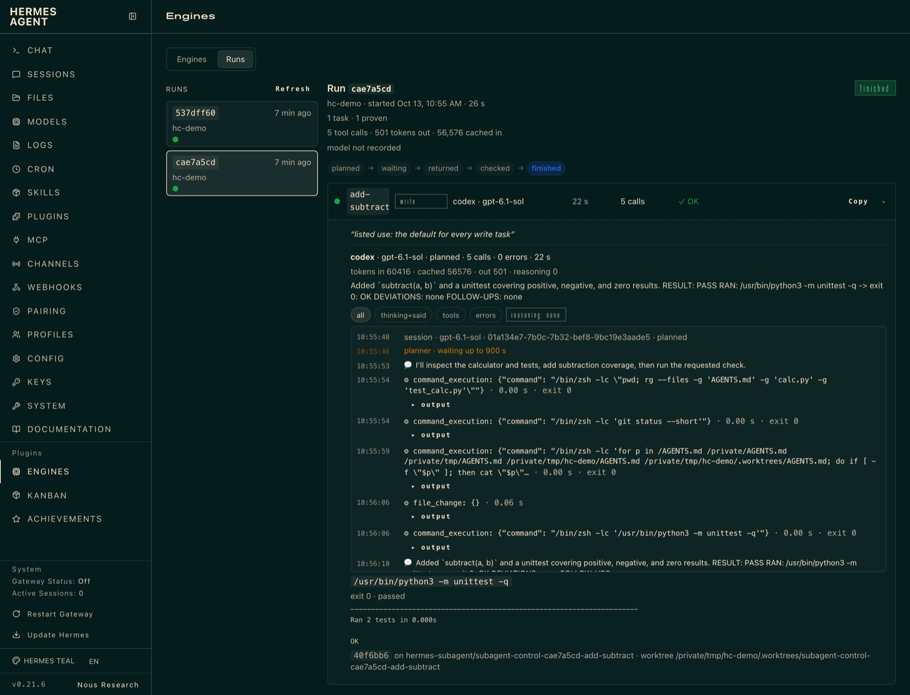
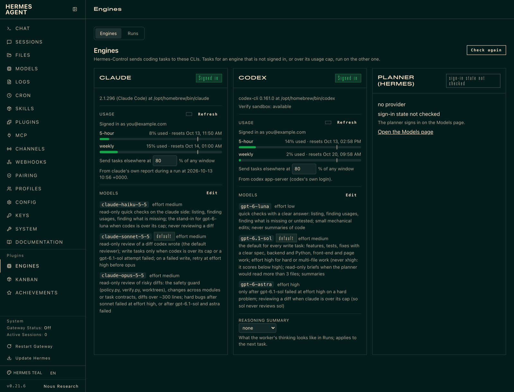
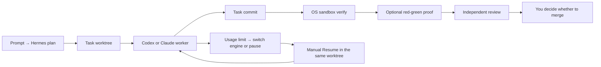

# Hermes-Control

Hermes-Control is an independent plugin for [Hermes Agent](https://github.com/NousResearch/hermes-agent) that delegates coding and review tasks to Claude Code, OpenAI Codex or, optionally, Google Antigravity (Gemini) in separate Git worktrees. It is for developers who already use Hermes and these CLIs and want task branches, check results and dashboard visibility before deciding what to merge.

[](LICENSE)

[](CHANGELOG.md)

## Status

Version 0.2.0 adds Gemini workers, reviewed diagrams, branch review and desktop integration; see the [changelog](CHANGELOG.md). Tested on macOS; Linux is untested. The plugin uses Hermes internal APIs, so a Hermes update can break it; see [Limitations](#limitations).

## What you get

- **Isolation:** each task works in its own Git worktree and branch.
- **Proof:** each finished commit is checked in an OS sandbox, with optional red-green proof.
- **Repo diagrams:** `hermes control diagram` draws reviewed designs and work flows in the dashboard's [Diagrams view](docs/diagrams-view.md).
- **Nothing merged for you:** review the branch and decide what reaches your repository.



<details>
<summary>Engines view: sign-in, usage caps and models per CLI</summary>



</details>

Screenshots come from a demo repository with real runs; the account email is replaced.

Hermes-Control is not affiliated with or endorsed by Nous Research, Anthropic, OpenAI or Google. Hermes Agent is a project of Nous Research; Claude and Claude Code are Anthropic products; Codex is an OpenAI product; Gemini and Antigravity are Google products. Names and marks belong to their owners and are used only to describe compatibility.

## Table of contents

[Status](#status) · [What you get](#what-you-get) · [Pipeline](#pipeline) · [Requirements](#requirements) ·
[Install and quick start](#install-and-quick-start) · [New install](#new-install) · [Upgrade from 0.1.0](#upgrade-from-010) ·
[What happens to your repository](#what-happens-to-your-repository) · [Example result](#what-a-result-looks-like) ·
[Security model](#security-model) · [Usage data](#usage-data) · [Limitations](#limitations) ·
[Use](#use) · [Settings](#settings) · [Update](#update) · [Tests](#tests) ·
[Troubleshooting](#troubleshooting) · [Uninstall](#uninstall) · [Layout](#layout) ·
[Support and contributing](#support-and-contributing) · [License](#license)

## Pipeline



The [detailed pipeline diagram](docs/hermes-control-flow.html) opens locally in a
browser. GitHub shows this HTML file as source; download it to view the diagram.

## Requirements

| Component | Tested version |
|---|---|
| macOS | 26.7 |
| Hermes Agent (agent plugin) | v0.22.5 (2026.9.24) |
| Hermes desktop (desktop plugin) | a Hermes desktop development build from upstream main (2026-10-23) |
| Claude Code (`claude`) | 2.1.314 |
| Codex (`codex-cli`) | 0.161.0 |
| Antigravity CLI (`agy`) | 1.4.12 (macOS) |

Linux has not yet been tested. These versions describe the tested setup; model
availability still depends on your account and allow-list.

- [Hermes Agent](https://github.com/NousResearch/hermes-agent) is the AI agent
  that plans tasks and runs this plugin; install it normally, with `hermes` on
  PATH and a model provider configured through `hermes model`.
- Sign in with `claude auth login` (or `/login` inside `claude`) and
  `codex login`, using your own accounts. Tasks sent to an engine that is
  signed out move to another available engine, in the order set by
  `routing.fallback` (see [Settings](#settings)).
- `codex` installed even if you only use claude: `codex sandbox` runs verification
  and needs no login for that step.
- Git and `uv` (for the test runner).

Hermes-Control runs in the Python environment that runs Hermes (with FastAPI
and Rich, which Hermes provides). The setup and check scripts need Bash; `uv`
installs pytest and PyYAML during setup for offline verification.

## Install and quick start

### New install

If you have never installed Hermes-Control, check the [requirements](#requirements)
first, then clone the repository and run setup:

```sh
git clone https://github.com/JanniezRubyjane/hermes-control.git
cd hermes-control
scripts/install.sh
scripts/verify-setup.sh
```

Optionally install Antigravity (`agy`) on PATH and run `agy` to sign in with your
own account. Enable `engines.gemini.enabled` and configure `models.gemini.default`
and the allowed models as shown in [Settings](#settings). Optionally install the
[desktop plugin](docs/desktop-plugin.md).

Restart Hermes so it loads the plugin and settings. If you use a gateway or
dashboard, restart those processes too. Then try the sample task:

```sh
hermes chat -q 'Use Hermes-Control to fix a typo in README.md; verify with /bin/sh scripts/sandbox-check.sh, then have claude review the branch.'
```

The sample asks for work on this checkout; start `hermes` from another Git
repository for your own task.

This links the plugin and planner skill into the Hermes home (default
`~/.hermes`) and puts `hc-update` in `~/.local/bin`. It also enables the plugin.
It is safe to re-run, and needed again after moving this repo. Existing non-link
entries are preserved under the Hermes home's `.hermes-control-replaced/`.

Every script that uses Hermes honors `HERMES_HOME`, including setup, checks,
update, evaluation and uninstall. `~/.local/bin` still follows `HOME`.
`verify-setup.sh` finds Hermes's interpreter (which must import `hermes_cli`
after bootstrap) from `HERMES_PYTHON` when set; otherwise it follows `hermes --print-runtime-command`
and records Hermes's import path. For a managed Hermes, an explicit
`HERMES_PYTHON` also needs `HERMES_PYTHON_PATH`: the repo root first, then the
managed env site-packages, colon-separated. Older launchers fall back to the
launcher or the install directory that `hermes --version` reports.
It also builds a read-only Python, pytest and Hermes source copy for Gemini workers
at `~/.config/hermes-control/check` (or `$XDG_CONFIG_HOME/hermes-control/check`).
Re-run setup after every Hermes update. Use `--no-agy-copy` to install only primary
verify; it reports any older Gemini copy left in place. See
[check setup](docs/usage.md#offline-checks) for dependency refresh steps.

### Upgrade from 0.1.0

In your existing 0.1.0 clone, pull the next release and re-run both setup scripts.
The public history is linear, with one commit per release:

```sh
cd /path/to/hermes-control
git pull
scripts/install.sh
scripts/verify-setup.sh
```

In 0.2.0, `install.sh` creates or refreshes the same three links: the plugin at
`$HERMES_HOME/plugins/hermes_control`, the planner skill at
`$HERMES_HOME/skills/software-development/hermes-control`, and `hc-update` at
`~/.local/bin/hc-update`. It enables the plugin with `hermes plugins enable
hermes_control`; there is no separate desktop-plugin install in this script.
As above, existing non-link entries are preserved. Re-running `verify-setup.sh`
installs pytest and PyYAML for offline checks, records the current Hermes runtime
and import path, and builds the read-only Python, pytest and Hermes source copy
for Gemini workers. A 0.1.0 verification environment may lack PyYAML or that copy.

Restart Hermes, the gateway process and the dashboard: plugin code loads once per
process, so each running process needs to load the updated code. Then check update
status (this command reports available updates without changing anything):

```sh
hc-update --check
```

You may notice these settings and behavior changes in 0.2.0. All keys below live
under `plugins.entries.hermes_control.settings`; existing configurations can leave
the optional keys unset:

| Setting | Default and effect |
|---|---|
| `engines.codex.enabled` | `true`; set `false` to disable Codex workers. Verification still requires `codex sandbox`, without sign-in. |
| `engines.gemini.enabled` | `false`; enable it to use the optional `agy` engine after signing in. |
| `engines.codex.paused`, `engines.gemini.paused` | `false`; dashboard toggles hold new work immediately while running tasks continue. |
| `models.gemini.default`, `models.gemini.allowed` | Unset, with no built-in model list or default. An omitted or empty allowed list is unrestricted; a nonempty list restricts models and supplies its first entry as the default if none is named. Gemini requires a resolved default before starting. See the example in [Settings](#settings). |
| `diagram.author` | Unset; selects the first enabled author, Codex then Gemini. An explicit value must be `codex` or `gemini` and enabled. Claude reviews the design. |
| `routing.fallback` | Unset; uses enabled-engine order. Set ordered engine/model destinations to customize handover. |
| `secret_scan.enabled`, `secret_scan.allow_paths` | `true`, `[]`; suspected secrets or scanner errors block task commits. |

Tasks now start from the calling session's working directory, rather than the
gateway's directory. On older Hermes versions without the session directory
resolver, the process working directory remains the fallback. Optional Gemini
usage readings are [unofficial, local-only and report-only](docs/limits-and-resume.md#antigravity-gemini-usage-source).
See the [0.2.0 changelog](CHANGELOG.md) for diagrams, branch review and desktop integration.

To roll back, run this in the clone, then restart Hermes, the gateway and the
dashboard:

```sh
git checkout v0.1.0
scripts/install.sh
```

## What happens to your repository

Task worktrees live at `<repo>/.worktrees/subagent-control-<run>-<task>` on
branches `hermes-subagent/subagent-control-<run>-<task>`. When Hermes creates
the first worktree, it appends `.worktrees/` to the repository's `.gitignore`
if the entry is missing; this shows up as an uncommitted change. Nothing is
merged or pushed. `hermes control prune` lists worktrees and branches;
`hermes control prune --apply` removes merged, clean worktrees and their branches.

## What a result looks like

Example output (illustrative):

```text
task update-docs  engine codex (gpt-6.1-sol, medium)  ok true
branch hermes-subagent/subagent-control-<run>-update-docs  commit <commit>
verify /bin/sh scripts/sandbox-check.sh -> exit 0: 100 passed, 5 deselected
verdict tests-passed  unproven_reason null
```

Review the diff and check output, then merge the branch yourself. With optional
red-green proof, the verdict can instead be `red-green-proven`.

## Security model

In short:

- **Sandboxed:** codex workers, gemini workers (agy runs with `--sandbox`), and
  every verify/red check (no network, no writes outside the checkout).
- **Not OS-sandboxed:** claude workers. They run Bash and edit files on your
  machine under Claude Code's permission mode, confined by `--restricted`.
- **Trusted:** the repository you point it at. Checks can read anything your user
  can read, so use it only on repositories you would run in your own shell.

Workers use your own claude/codex logins and quotas. Codex workers run in
Codex's OS sandbox. Claude workers run with `--restricted` when the installed
`claude --help` lists it. Measured with Claude Code 2.1.295: a repository's
committed `.claude` hooks did not run, `CLAUDE.md` still loaded, and reads outside
the worktree were refused. Without that flag, a task is refused when its base
commit contains `.claude` settings or a `.claude` symlink.

Codex has no option to skip project config, so tasks are refused when the base
commit tracks anything under `.codex/` or a `.codex` symlink. A continued task is
refused if its worktree changed `.claude/` for Claude or `.codex/` for Codex.

Gemini workers run agy with `--sandbox`, and only when its machine-wide settings
keep the terminal sandbox on and use a reviewed permission mode; unknown settings
are refused. agy loads `.agents/` and `.gemini/` project files, so a task is refused
when its base commit tracks either, and a continued task is refused if its
worktree changed them.

Controller Git runs with Hermes's repository-hardened environment: hooks,
fsmonitor and repository filter drivers are neutralised. Commit messages,
verify/red output, `unproven_reason` and result text are redacted for known secret
formats. Redaction cannot recognize every secret.

The verify sandbox blocks writes outside its checkout (apart from sandbox temporary
storage) and blocks the network, but permits reads. Only point it at repositories
you would run in your own shell. Its proof applies to the task's commit in a clean
checkout. Nothing is merged automatically. The dashboard relies on Hermes's
session token; protect that token and the Hermes dashboard access.

`scripts/merge_check.sh --unsandboxed` runs code with the permissions and network
access of your shell. Review the diffs before selecting it.

Every task, and every review round, uses your claude/codex subscription or API
quota; Hermes's own planner model has its own cost.

## Usage data

Codex usage comes from the official `codex app-server`. Claude usage comes only
from claude's own `rate_limit_event` during tasks, with account status from
`claude auth status`. Refresh reads that status and the saved report; without a
valid report, usage is unknown and does not hold work back.

The Claude model list combines CLI aliases with Hermes's built-in list; no
account is contacted. The Engines page shows the planner's provider and model
from config without checking its sign-in. Use Hermes's Models page to sign in.

## Limitations

- Linux is untested.
- Child processes that call `setsid` can outlive cleanup.
- The plugin lives outside the Hermes tree, so `hermes update` updates Hermes
  independently. It depends on Hermes internal modules from `tools/`, `hermes_cli/` and
  `agent/`; `hc-update` checks compatibility after updating Hermes.
- Model names in examples are examples. Your allow-list decides which models
  and routes the planner may use.

## Use

Start Hermes from the Git repository you want to work on and describe the task.
`control_dispatch` uses the calling session's working directory to select the
repository and create isolated task worktrees. It uses Hermes's session directory
resolver when available, falling back to the process working directory on older
Hermes versions without that resolver.
Pin an engine with `@claude`, `@codex`, or `@gemini`; review the resulting branch before merging.
See [Usage](docs/usage.md) for every command and setting, including proof,
stall detection, models and effort, usage limits, Resume, parallel tasks, run
inspection, pruning and routing evaluation.

See [Desktop plugin](docs/desktop-plugin.md) for setup, the status-bar chip, Engines and Runs in the Hermes desktop app.

## Settings

Engine and model settings live under
`plugins.entries.hermes_control.settings` in Hermes config. Gemini is optional:
set `engines.gemini.enabled: true`, sign in through `agy`, and restart Hermes.
Gemini tasks require `models.gemini.default`; without it, the controller refuses
before starting. Gemini efforts are `low`, `medium` and `high`; agy always receives
`--model <base>-<effort>`. This example lists a default writer, quick checks and
Claude reviewers available through agy:

```yaml
plugins:
  entries:
    hermes_control:
      settings:
        engines:
          gemini: {enabled: true}
        models:
          gemini:
            default: gemini-4-argon
            allowed:
              gemini-4-argon: {use_for: the default for every write task, effort: medium}
              gemini-3.8-flash: {use_for: quick checks only; never reviews, effort: low}
              claude-sonnet-5-5: {use_for: only as the reviewer when claude cannot run; routine diffs, effort: medium}
              claude-opus-5-5: {use_for: only as the reviewer when claude cannot run; risky diffs, effort: medium}
        routing:
          fallback:
            codex: [gemini, claude]
            claude: [gemini, codex/gpt-6-astra]
            gemini: [codex, claude]
```

`settings.secret_scan` checks added lines and new files before committing a task,
including resumed tasks. It defaults to `enabled: true` and `allow_paths: []`.
Binary files are scanned too; only the first 2 MB of each file is scanned. A possible
secret blocks the commit, names only the path, line and rule in the reason, and
leaves the change unstaged in the task worktree. Scanner errors also block the
commit. A blocked change's blobs may remain in `.git/objects` as unreferenced
loose objects until `git gc` prunes them; they are on no branch and never pushed.
Invalid settings warn and keep scanning with defaults. To exempt test fixtures,
use repo-relative glob paths under the same `settings` mapping in `config.yaml`.
`allow_paths` uses Python `fnmatch` semantics, where `*` also matches `/`:

```yaml
secret_scan:
  enabled: true
  allow_paths: ["tests/fixtures/secrets/**"]
```

Set `secret_scan.enabled: false` to skip the check.

`settings.routing.fallback` maps a source engine to an ordered list of `engine`
or `engine/model` destinations, used for sign-in failures and cap/limit handover.
On a move, the controller keeps the planned model if the destination explicitly
allows it, otherwise uses the entry's model, otherwise the destination default.
The reroute note reports `model_rule` as `kept`, `fallback_entry` or `default`.
A kept model also keeps a valid effort; otherwise its configured effort applies.
An entry model must be allowed by the destination. Configure other engines' model
lists alongside Gemini; the example's `gpt-6-astra` must be in codex's allowed list
if that list restricts models.

Sources omitted from `fallback` keep the enabled-engine order; an empty list
forbids moving that source. Disabled engines are skipped with a warning; unknown
engines are rejected. With no fallback setting, routing stays unchanged. To use
Gemini as the writer without codex, use `gemini: [claude]` and `claude: [gemini]`.
Model names are examples; your allowed models and listed uses decide the work.
For a branch routing evaluation, use `python scripts/eval/run.py --plugin-root
<branch-checkout> --live`; this links the evaluation profile to that checkout's
plugin and skill. Omitting `--plugin-root` resolves the existing installed symlinks.

Codex is enabled by default (`engines.codex.enabled: true`); set
`engines.codex.enabled: false` and restart Hermes when a Codex subscription lapses.
Disabling codex omits it from the planner tool schema, pins, model descriptions and
fallback destinations, routes any codex-planned or pinned task to the next engine in
your fallback order, and stops `limits` and the dashboard Engines tab from querying
`codex app-server`. Historical codex runs still appear in `watch`, `review_pack`,
`lessons` and `stats`, and the post-commit check keeps using `codex sandbox` (which
does not require sign-in).

## Update

```bash
hc-update            # hermes update, then this repo's tests against the new Hermes
hc-update --check    # report whether Hermes or this repo is behind; no tests, no changes
```

The plugin's own code updates with `git pull` in this repo.
`hc-update --check` runs no tests. Other update invocations run the compatibility suite.

## Tests

```bash
scripts/check.sh                   # fast suite, against the Hermes that `hermes` runs
scripts/check.sh -m integration    # also drives the real claude/codex CLIs
```

pytest and PyYAML come from a throwaway `uv` overlay; the Hermes venv is never modified.
The offline verify command, after `scripts/verify-setup.sh`, is:

```sh
/bin/sh scripts/sandbox-check.sh
```

Hermes-Control runs it in its sandbox; invoking the script directly uses your
current shell. The Gemini adapter sets `HERMES_CONTROL_CHECK_COPY=1` for workers.
Only with that opt-in, `CODEX_SANDBOX` unset and primary verify unreadable can the
check use the read-only copy. Four tests requiring Git metadata or the real Hermes
CLI are left to post-commit verify unless explicitly selected. Post-commit verify
runs in the Codex sandbox and cannot use the copy; an unavailable primary keeps
the not-set-up error (exit 2). See [Contributing](CONTRIBUTING.md) for the
tests-first workflow.

## Troubleshooting

- **`hc-update` says the tests fail.** Hermes changed something the plugin uses:
  the internal helpers it imports from `tools/`, `hermes_cli/` and `agent/`. The
  failing test names the piece. Fix it here. To get back to a working Hermes in the
  meantime, check out its previous commit in the Hermes install directory (shown by
  `hermes --version`) and re-sync that venv as the Hermes installer does.
- **claude cannot edit, but codex can.** Claude Code treats everything under
  `~/.claude` as sensitive and refuses edits there even in accept-edits mode
  ("... which is a sensitive file"), so keep repos you hand to claude elsewhere.
- **codex fails with 400 "model is not supported when using Codex with a ChatGPT
  account".** The installed codex is older than the model. Upgrade codex (see
  [Models and effort](docs/usage.md#models-and-effort)), then check that
  `codex debug models` lists it.
- **The Engines tab is missing.** Check that the `plugins/hermes_control` path
  under `~/.hermes` (or `$HERMES_HOME`) is a link to this repo (re-run
  `scripts/install.sh`) and that the plugin is enabled
  (`hermes plugins list`). To enable it again, run `hermes plugins enable hermes_control`.

## Uninstall

```sh
scripts/uninstall.sh          # keep run logs
scripts/uninstall.sh --purge  # also remove run logs and plugin data under control/
```

Usage: `scripts/uninstall.sh [--purge]`. Omit `--purge` to keep run logs,
paused-task records and the verification environment. Pass `--purge` to also
remove the plugin's own files under the Hermes home's `control/` directory
(`verify/`, run logs and locks, `usage-claude.json`, `paused/`, `checks/`,
`reviews/`, `diagrams/` and `slots/`); `settings-backups/` and any other user
files under `control/` are kept. The script disables the plugin and removes
only symlinks belonging to this checkout; task worktrees in repositories remain
available for review.

For an install under `~/.hermes` (or `$HERMES_HOME`), the original manual unlink
commands also work (and keep run logs). The commands below use the default home;
replace `~/.hermes` with `$HERMES_HOME` if configured:

```sh
hermes plugins disable hermes_control
rm ~/.hermes/plugins/hermes_control ~/.hermes/skills/software-development/hermes-control ~/.local/bin/hc-update
```

## Layout

| Path | What |
|---|---|
| `hermes_control/plugin.yaml` | Plugin metadata and tested versions |
| `hermes_control/` | Dispatch/status tools, engine adapters, guards and dashboard assets |
| `skills/hermes-control/SKILL.md` | Planner instructions |
| `skills/hermes-control/references/` | Verification, review, limits and dependency guidance |
| `scripts/` | Install/uninstall, update, checks, public export and evaluation tools |
| `tests/` | Pytest suite, including disposable-repository export tests |
| `docs/design.md` | Dispatch design |
| `docs/engines-dashboard.md` | Engines dashboard guide |
| `docs/desktop-plugin.md` | Desktop plugin requirements, setup and pages |
| `docs/limits-and-resume.md` | Usage routing and Resume |
| `docs/runs-view.md` | Run inspection guide |
| `docs/hermes-control-flow.html` | Detailed pipeline diagram |
| `docs/usage.md` | Detailed commands, settings and routing evaluation |
| `THIRD_PARTY.md` | Notices and licenses for third-party material shown or quoted |
| `LICENSE`, `SECURITY.md`, `CONTRIBUTING.md`, `CHANGELOG.md` | License, reporting, contributor workflow and release notes |

## Support and contributing

See [SUPPORT.md](SUPPORT.md) for help and [SECURITY.md](SECURITY.md) for private
vulnerability reporting. [CONTRIBUTING.md](CONTRIBUTING.md) describes the tests,
second reviews of safety guards and public export; follow the
[CODE_OF_CONDUCT.md](CODE_OF_CONDUCT.md). Release notes are in
[CHANGELOG.md](CHANGELOG.md).

## License

Hermes-Control is licensed under the [MIT License](LICENSE). Copyright (c) 2026 JanniezRubyjane. CODE_OF_CONDUCT.md is Contributor Covenant 2.1 under CC BY 4.0. Third-party material shown or quoted keeps its own license; see [THIRD_PARTY.md](THIRD_PARTY.md).

[MIT](LICENSE) · Copyright (c) 2026 JanniezRubyjane ·
[Report vulnerabilities privately](SECURITY.md)
