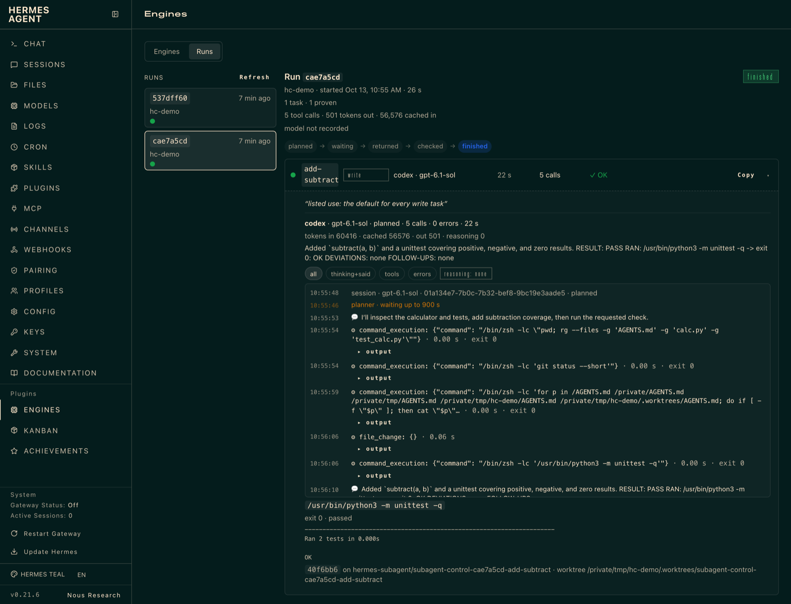
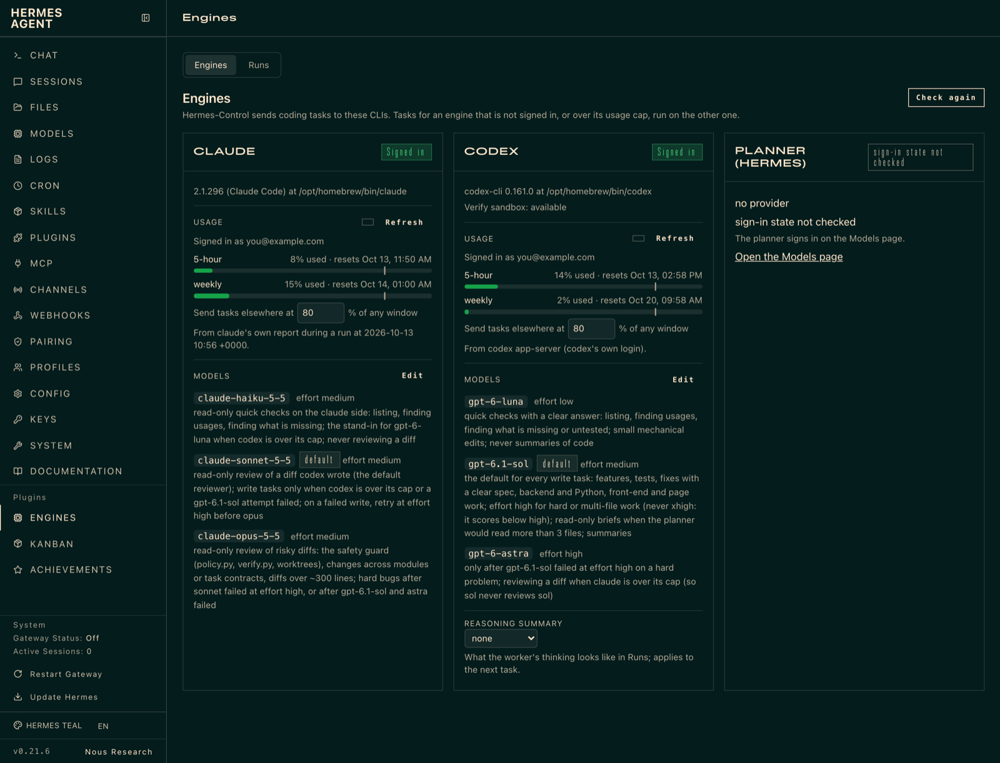
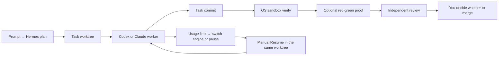

# Hermes-Control

Hermes-Control is an independent plugin for [Hermes Agent](https://github.com/NousResearch/hermes-agent) that delegates coding and review tasks to Claude Code or OpenAI Codex in separate Git worktrees. It is for developers who already use Hermes and these CLIs and want task branches, check results and dashboard visibility before deciding what to merge.

[](LICENSE)

[](CHANGELOG.md)

## Status

Version 0.1.0 is the first public release. Tested on macOS; Linux is untested. The plugin uses Hermes internal APIs, so a Hermes update can break it; see [Limitations](#limitations).

## What you get

- **Isolation:** each task works in its own Git worktree and branch.
- **Proof:** each finished commit is checked in an OS sandbox, with optional red-green proof.
- **Nothing merged for you:** review the branch and decide what reaches your repository.



<details>
<summary>Engines view: sign-in, usage caps and models per CLI</summary>



</details>

Screenshots come from a demo repository with real runs; the account email is replaced.

Hermes-Control is not affiliated with or endorsed by Nous Research, Anthropic or OpenAI. Hermes Agent is a project of Nous Research; Claude and Claude Code are Anthropic products; Codex is an OpenAI product. Names and marks belong to their owners and are used only to describe compatibility.

## Table of contents

[Status](#status) · [What you get](#what-you-get) · [Pipeline](#pipeline) · [Requirements](#requirements) ·
[Install and quick start](#install-and-quick-start) ·
[What happens to your repository](#what-happens-to-your-repository) · [Example result](#what-a-result-looks-like) ·
[Security model](#security-model) · [Usage data](#usage-data) · [Limitations](#limitations) ·
[Use](#use) · [Update](#update) · [Tests](#tests) ·
[Troubleshooting](#troubleshooting) · [Uninstall](#uninstall) · [Layout](#layout) ·
[Support and contributing](#support-and-contributing) · [License](#license)

## Pipeline



The [detailed pipeline diagram](docs/hermes-control-flow.html) opens locally in a
browser. GitHub shows this HTML file as source; download it to view the diagram.

## Requirements

| Component | Tested version |
|---|---|
| macOS | 26.7 |
| Hermes Agent | v0.21.6 (2026.9.24) |
| Claude Code (`claude`) | 2.1.296 |
| Codex (`codex-cli`) | 0.161.0 |

Linux has not yet been tested. These versions describe the tested setup; model
availability still depends on your account and allow-list.

- [Hermes Agent](https://github.com/NousResearch/hermes-agent) is the AI agent
  that plans tasks and runs this plugin; install it normally, with `hermes` on
  PATH and a model provider configured through `hermes model`.
- Sign in with `claude auth login` (or `/login` inside `claude`) and
  `codex login`, using your own accounts. Tasks sent to an engine that is
  signed out move to the other one.
- `codex` installed even if you only use claude: `codex sandbox` runs verification
  and needs no login for that step.
- Git and `uv` (for the test runner).

Hermes-Control runs in the Python environment that runs Hermes (with FastAPI,
Rich and PyYAML, which Hermes provides). The setup and check scripts need Bash;
`uv` installs the test runner during setup for offline verification.

## Install and quick start

After installing the requirements, run these four commands. The sample asks for
work on this checkout; start `hermes` from another Git repository for your own task.

```sh
git clone https://github.com/JanniezRubyjane/hermes-control.git && cd hermes-control
scripts/install.sh
scripts/verify-setup.sh
hermes chat -q 'Use Hermes-Control to fix a typo in README.md; verify with /bin/sh scripts/sandbox-check.sh, then have claude review the branch.'
```

This links the plugin and planner skill into the Hermes home (default
`~/.hermes`) and puts `hc-update` in `~/.local/bin`. It also enables the plugin.
It is safe to re-run, and needed again after moving this repo. Existing non-link
entries are preserved under the Hermes home's `.hermes-control-replaced/`.

Every script that uses Hermes honors `HERMES_HOME`, including setup, checks,
update, evaluation and uninstall. `~/.local/bin` still follows `HOME`.
`verify-setup.sh` finds Hermes's interpreter (which must import `hermes_cli`) from
`HERMES_PYTHON`, the launcher, or the install directory that `hermes --version` reports.

## What happens to your repository

Task worktrees live at `<repo>/.worktrees/subagent-control-<run>-<task>` on
branches `hermes-subagent/subagent-control-<run>-<task>`. When Hermes creates
the first worktree, it appends `.worktrees/` to the repository's `.gitignore`
if the entry is missing; this shows up as an uncommitted change. Nothing is
merged or pushed. `hermes control prune` lists worktrees and branches;
`hermes control prune --apply` removes merged, clean worktrees and their branches.

## What a result looks like

Example output (illustrative):

```text
task update-docs  engine codex (gpt-6.1-sol, medium)  ok true
branch hermes-subagent/subagent-control-1a2b3c4d-update-docs  commit abc1234
verify /bin/sh scripts/sandbox-check.sh -> exit 0: 100 passed, 5 deselected
verdict tests-passed  unproven_reason null
```

Review the diff and check output, then merge the branch yourself. With optional
red-green proof, the verdict can instead be `red-green-proven`.

## Security model

In short:

- **Sandboxed:** codex workers, and every verify/red check (no network, no writes
  outside the checkout).
- **Not OS-sandboxed:** claude workers. They run Bash and edit files on your
  machine under Claude Code's permission mode, confined by `--restricted`.
- **Trusted:** the repository you point it at. Checks can read anything your user
  can read, so use it only on repositories you would run in your own shell.

Workers use your own claude/codex logins and quotas. Codex workers run in
Codex's OS sandbox. Claude workers run with `--restricted` when the installed
`claude --help` lists it. Measured with Claude Code 2.1.295: a repository's
committed `.claude` hooks did not run, `CLAUDE.md` still loaded, and reads outside
the worktree were refused. Without that flag, a task is refused when its base
commit contains `.claude` settings or a `.claude` symlink.

Codex has no option to skip project config, so tasks are refused when the base
commit tracks anything under `.codex/` or a `.codex` symlink. A continued task is
refused if its worktree changed `.claude/` for Claude or `.codex/` for Codex.

Controller Git runs with Hermes's repository-hardened environment: hooks,
fsmonitor and repository filter drivers are neutralised. Commit messages,
verify/red output, `unproven_reason` and result text are redacted for known secret
formats. Redaction cannot recognize every secret.

The verify sandbox blocks writes outside its checkout (apart from sandbox temporary
storage) and blocks the network, but permits reads. Only point it at repositories
you would run in your own shell. Its proof applies to the task's commit in a clean
checkout. Nothing is merged automatically. The dashboard relies on Hermes's
session token; protect that token and the Hermes dashboard access.

`scripts/merge_check.sh --unsandboxed` runs code with the permissions and network
access of your shell. Review the diffs before selecting it.

Every task, and every review round, uses your claude/codex subscription or API
quota; Hermes's own planner model has its own cost.

## Usage data

Codex usage comes from the official `codex app-server`. Claude usage comes only
from claude's own `rate_limit_event` during tasks, with account status from
`claude auth status`. Refresh reads that status and the saved report; without a
valid report, usage is unknown and does not hold work back.

The Claude model list combines CLI aliases with Hermes's built-in list; no
account is contacted. The Engines page shows the planner's provider and model
from config without checking its sign-in. Use Hermes's Models page to sign in.

## Limitations

- Linux is untested.
- Child processes that call `setsid` can outlive cleanup.
- The plugin lives outside the Hermes tree, so `hermes update` updates Hermes
  independently. It depends on Hermes internal modules from `tools/`, `hermes_cli/` and
  `agent/`; `hc-update` checks compatibility after updating Hermes.
- Model names in examples are examples. Your allow-list decides which models
  and routes the planner may use.

## Use

Start Hermes from the Git repository you want to work on and describe the task.
Pin an engine with `@claude` or `@codex`; review the resulting branch before merging.
See [Usage](docs/usage.md) for every command and setting, including proof,
stall detection, models and effort, usage limits, Resume, parallel tasks, run
inspection, pruning and routing evaluation.

## Update

```bash
hc-update            # hermes update, then this repo's tests against the new Hermes
hc-update --check    # report whether Hermes or this repo is behind; no tests, no changes
```

The plugin's own code updates with `git pull` in this repo.
`hc-update --check` runs no tests. Other update invocations run the compatibility suite.

## Tests

```bash
scripts/check.sh                   # fast suite, against the Hermes that `hermes` runs
scripts/check.sh -m integration    # also drives the real claude/codex CLIs
```

pytest comes from a throwaway `uv` overlay; the Hermes venv is never modified.
The offline verify command, after `scripts/verify-setup.sh`, is:

```sh
/bin/sh scripts/sandbox-check.sh
```

Hermes-Control runs it in its sandbox; invoking the script directly uses your
current shell. See [Contributing](CONTRIBUTING.md) for the tests-first workflow.

## Troubleshooting

- **`hc-update` says the tests fail.** Hermes changed something the plugin uses:
  the internal helpers it imports from `tools/`, `hermes_cli/` and `agent/`. The
  failing test names the piece. Fix it here. To get back to a working Hermes in the
  meantime, check out its previous commit in the Hermes install directory (shown by
  `hermes --version`) and re-sync that venv as the Hermes installer does.
- **claude cannot edit, but codex can.** Claude Code treats everything under
  `~/.claude` as sensitive and refuses edits there even in accept-edits mode
  ("... which is a sensitive file"), so keep repos you hand to claude elsewhere.
- **codex fails with 400 "model is not supported when using Codex with a ChatGPT
  account".** The installed codex is older than the model. Upgrade codex (see
  [Models and effort](docs/usage.md#models-and-effort)), then check that
  `codex debug models` lists it.
- **The Engines tab is missing.** Check that the `plugins/hermes_control` path
  under `~/.hermes` (or `$HERMES_HOME`) is a link to this repo (re-run
  `scripts/install.sh`) and that the plugin is enabled
  (`hermes plugins list`). To enable it again, run `hermes plugins enable hermes_control`.

## Uninstall

```sh
scripts/uninstall.sh          # keep run logs
scripts/uninstall.sh --purge  # also remove run logs and plugin data under control/
```

Usage: `scripts/uninstall.sh [--purge]`. Omit `--purge` to keep run logs,
paused-task records and the verification environment. Pass `--purge` to also
remove the plugin's own files under the Hermes home's `control/` directory.
The script disables the plugin and removes only symlinks belonging to this
checkout; task worktrees in repositories remain available for review.

For an install under `~/.hermes` (or `$HERMES_HOME`), the original manual unlink
commands also work (and keep run logs). The commands below use the default home;
replace `~/.hermes` with `$HERMES_HOME` if configured:

```sh
hermes plugins disable hermes_control
rm ~/.hermes/plugins/hermes_control ~/.hermes/skills/software-development/hermes-control ~/.local/bin/hc-update
```

## Layout

| Path | What |
|---|---|
| `hermes_control/plugin.yaml` | Plugin metadata and tested versions |
| `hermes_control/` | Dispatch/status tools, engine adapters, guards and dashboard assets |
| `skills/hermes-control/SKILL.md` | Planner instructions |
| `skills/hermes-control/references/` | Verification, review, limits and dependency guidance |
| `scripts/` | Install/uninstall, update, checks, public export and evaluation tools |
| `tests/` | Pytest suite, including disposable-repository export tests |
| `docs/design.md` | Dispatch design |
| `docs/engines-dashboard.md` | Engines dashboard guide |
| `docs/limits-and-resume.md` | Usage routing and Resume |
| `docs/runs-view.md` | Run inspection guide |
| `docs/hermes-control-flow.html` | Detailed pipeline diagram |
| `docs/usage.md` | Detailed commands, settings and routing evaluation |
| `THIRD_PARTY.md` | Notices and licenses for third-party material shown or quoted |
| `LICENSE`, `SECURITY.md`, `CONTRIBUTING.md`, `CHANGELOG.md` | License, reporting, contributor workflow and release notes |

## Support and contributing

See [SUPPORT.md](SUPPORT.md) for help and [SECURITY.md](SECURITY.md) for private
vulnerability reporting. [CONTRIBUTING.md](CONTRIBUTING.md) describes the tests,
second reviews of safety guards and public export; follow the
[CODE_OF_CONDUCT.md](CODE_OF_CONDUCT.md). Release notes are in
[CHANGELOG.md](CHANGELOG.md).

## License

Hermes-Control is licensed under the [MIT License](LICENSE). Copyright (c) 2026 JanniezRubyjane. CODE_OF_CONDUCT.md is Contributor Covenant 2.1 under CC BY 4.0. Third-party material shown or quoted keeps its own license; see [THIRD_PARTY.md](THIRD_PARTY.md).

[MIT](LICENSE) · Copyright (c) 2026 JanniezRubyjane ·
[Report vulnerabilities privately](SECURITY.md)
